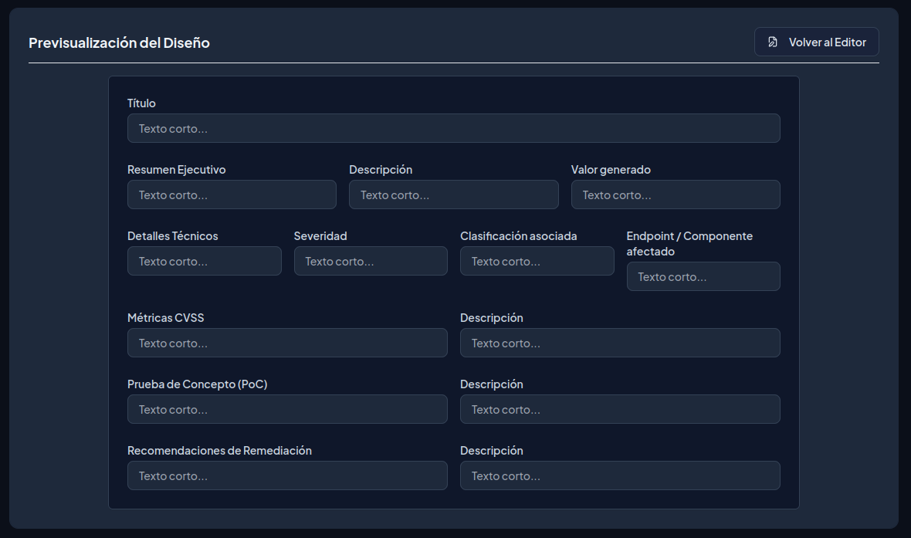

Objetivo 3: Armado de Plantilla Base de Reporte
Como pentester, tu entregable final es el reporte. Diseña y personaliza tu propia plantilla de reporte profesional. Esta será la herramienta que utilizarás en el resto del curso y en tu vida profesional. La plantilla debe contener obligatoriamente las siguientes secciones: Resumen Ejecutivo (para directivos), Detalles Técnicos, Métricas CVSS, Prueba de Concepto (PoC) detallada paso a paso, y Recomendaciones de Remediación. Explicar la estructura de la plantilla y que valor genera al usuario final que lee un ticket realizado con dicha plantilla. Formato de entrega: Enlace al archivo .md.

# Objetivo 3: Armado de Plantilla Base de Reporte

## Estructura de la Plantilla Base de Reporte

### Resumen Ejecutivo
* **Descripción:** Sección orientada a gerentes, directores y C-level. Explica en lenguaje de negocio (sin tecnicismos excesivos) el estado general de la seguridad de la aplicación, el impacto potencial de los hallazgos críticos y un resumen métrico del riesgo global.
* **Valor generado:** Permite a los directivos tomar decisiones informadas sobre la asignación de presupuestos y recursos para la mitigación de riesgos sin necesidad de leer detalles de código fuente.

### Detalles Técnicos
* **Descripción:** Apartado riguroso que documenta la naturaleza técnica de cada hallazgo. Incluye:
  * **Título descriptivo y Severidad** (Crítica, Alta, Media, Baja).
  * **Clasificación asociada:** Identificadores **CWE** (debilidad de código) y **CVE** (si aplica a componentes de terceros).
  * **Endpoint / Componente afectado:** URL exacta, parámetro vulnerable o librería comprometida.

### Métricas CVSS
* **Descripción:** Evaluación estandarizada del riesgo mediante el vector y la puntuación **CVSS v3.1 / v4.0**. Desglosa métricas clave como:
  * **Vector de Ataque (AV):** Red, Adyacente, Local, Físico.
  * **Complejidad de Ataque (AC):** Baja o Alta.
  * **Privilegios Requeridos (PR):** Ninguno, Bajos, Altos.
  * **Interacción del Usuario (UI):** Ninguna o Requerida.
  * **Alcance (S):** Cambiado o Sin Cambios.
  * **Impacto:** Confidencialidad (C), Integridad (I) y Disponibilidad (A).

### Prueba de Concepto (PoC)
* **Descripción:** Demostración práctica y replicable que comprueba la existencia real de la vulnerabilidad. Incluye peticiones HTTP/HTTPS (Headers, Payloads, Responses), capturas de pantalla, scripts exploit y comandos ejecutados.

### Recomendaciones de Remediación
* **Descripción:** Soluciones técnicas y mejores prácticas ajustadas al lenguaje de programación o arquitectura evaluada. Incluye fragmentos de código corregido, parches de actualización y configuraciones de seguridad defensiva.

---

## Valor Generado al Usuario Final y Equipos de Trabajo

La utilización de esta plantilla para la confección de informes y tickets aporta un valor estratégico diferenciado a los distintos actores de la organización:

| Perfil / Receptor | Beneficio y Valor Clave Generado |
| :--- | :--- |
| **C-Level / CISOs / Gerencia** | **Visibilidad del riesgo de negocio:** Permite justificar inversiones en ciberseguridad, priorizar recursos y evaluar el cumplimiento regulatorio (p. ej. ISO 27001, PCI-DSS, GDPR). |
| **Líderes Técnicos / PMs** | **Priorización del Backlog:** Facilita la asignación eficiente de tareas según la severidad CVSS y el impacto operacional. |
| **Desarrolladores / DevSecOps** | **Aceleración del parcheo:** Al contar con PoCs claros y código de remediación sugerido, evitan perder tiempo adivinando cómo reproducir o solucionar el problema. |
| **QA / Tester de Software** | **Validación de corrección (Re-testing):** Proporciona un procedimiento inequívoco para verificar que la vulnerabilidad ha sido subsanada de forma efectiva. |
